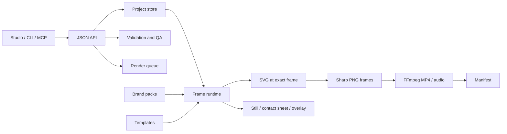

# Architecture

## One project, several surfaces

`MotionProject` v2 is the only document model. Studio, CLI, MCP tools and HTTP clients all create or patch the same JSON. Templates instantiate ordinary scenes; brand packs resolve semantic tokens at render time; the exporter asks the runtime for exact frames.

## Determinism

- time derives from `frame / fps`; no wall-clock state enters a composition;
- background geometry uses a project-and-brand seeded pseudo-random generator;
- scene selection uses cumulative duration and stable IDs;
- the same `renderFrameSvg()` path drives preview, stills, contact sheets and MP4 frames;
- manifests hash the complete canonical spec.

## Brand boundary

Colours are semantic names, not arbitrary values. Resolution follows engine → brand → template → project → scene → layer. Unknown layer colour tokens fail validation. Product metadata restricts known product/brand mismatches. Custom packs are versioned JSON stored under `.motion-foundry/brands` and registered into the same runtime.

## Responsive compositions

The runtime branches on composition geometry. Portrait layouts use vertical process disclosure, shorter line measures and larger relative safe areas; landscape layouts use horizontal flow and wider measures. This is not uniform scaling.

## Long-form media

Projects include narration, music, video, presenter, demo and caption tracks. Audio assets are mixed and muxed during FFmpeg export; scene and global caption cues render from the same frame time and can be exported as sidecars. Presenter, image and video layers share the generic timed layer contract.

Visual tracks expose a `composite` contract:

- `zIndex` and `fit` layer a full-frame isolated subject over a replacement background; the geometry fields also support other deterministic placements when a project needs them;
- `opacity` and `blendMode` provide normal overlays plus addition, multiply, screen, overlay, darken, lighten, difference, hard-light and soft-light combinations;
- `key` removes chroma or RGB colours for generated or filmed green-screen foregrounds, with optional green/blue spill suppression;
- `mask` uses a luma or alpha video as the foreground matte and supports inversion plus edge feathering;
- `provenance` records generated-media source, role, workflow profile, host,
  workflow hash, model hashes, prompt ID, QA evidence and review state on
  tracks, layer assets and masks;
- `crop`, `trimStart`, `loop` and track timing select the required source region and interval;
- `includeAudio` routes a visual track's audio through the timed project mixer, with the track `volume` applied.

Blend modes operate on full-frame tracks with `fit` set to `cover` or `fill`. Positioned, keyed and masked foregrounds use normal composition. Validation enforces this boundary so a project does not silently produce a mathematically different blend.

Set `qa.generatedMediaProvenanceRequired` for projects that consume ComfyUI
assets. Validation then rejects un-attributed track, layer and mask assets.
Render manifests preserve the provenance records and SHA-256-hash every
referenced asset that is available under the Motion Foundry project root.

Set `render.graphics` to `false` for a clean video-only background replacement. Leave it enabled when the project also needs Motion Foundry titles, captions or diagrams above the composited video.

## Renderer policy

The renderer is SVG → Sharp → FFmpeg. It requires no browser, paid licence, hosted API or cloud worker and operates predictably on the local machine. Paid and metered renderer adapters are outside the project boundary. Keep frame, still, contact-sheet, scene-render, full-render and manifest operations local and zero-cost.

## Queue and resumability

Render jobs are persisted before work begins. Jobs found in `running` state on service restart return to `queued`. Idempotency keys prevent duplicate submission; content hashes provide the cache boundary. Stage-specific errors are stored with each job.
